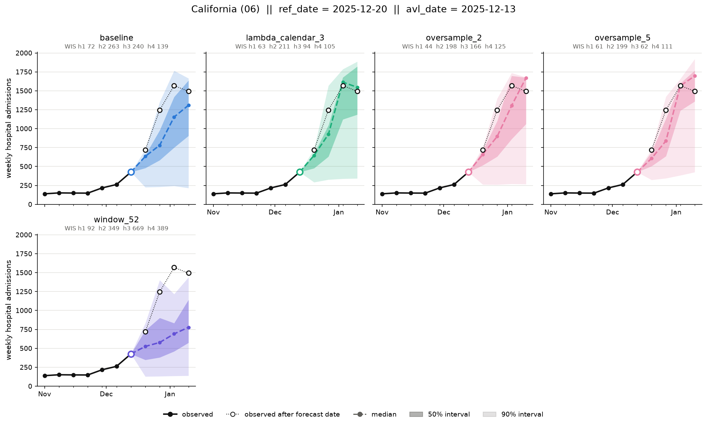
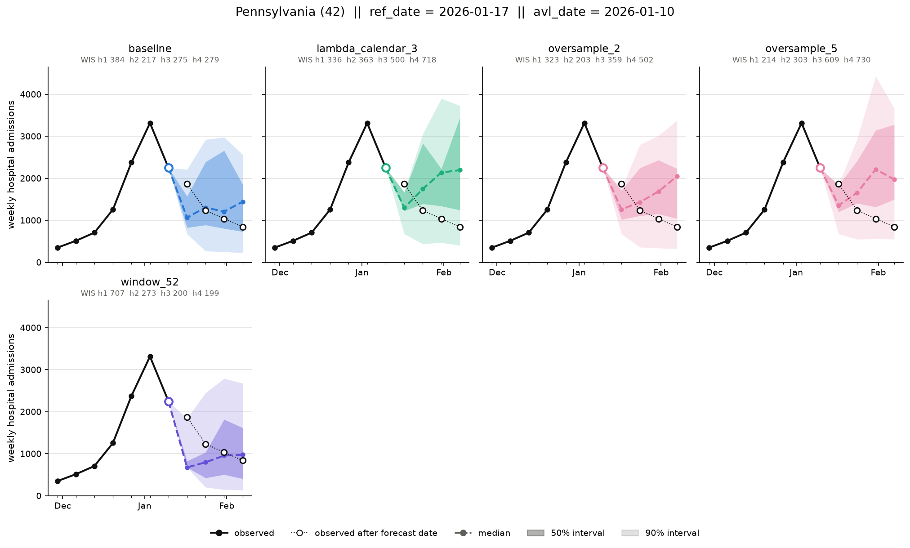
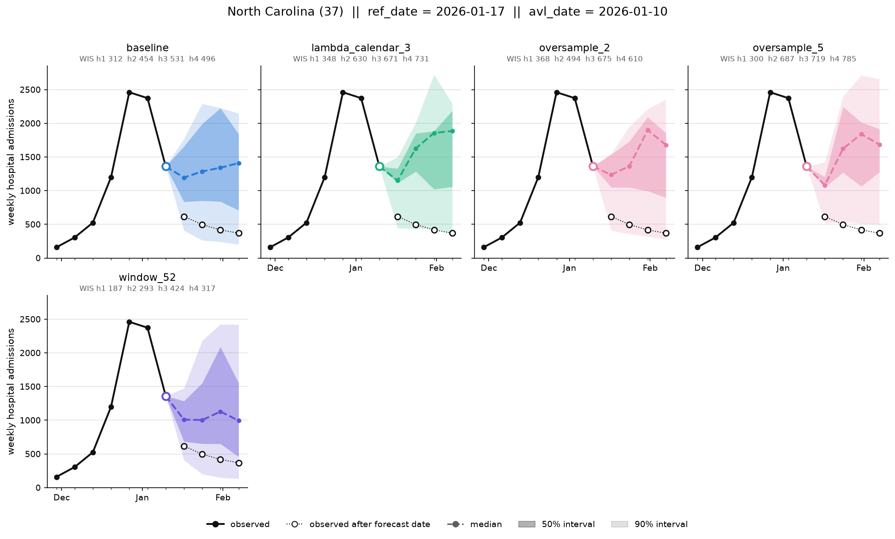
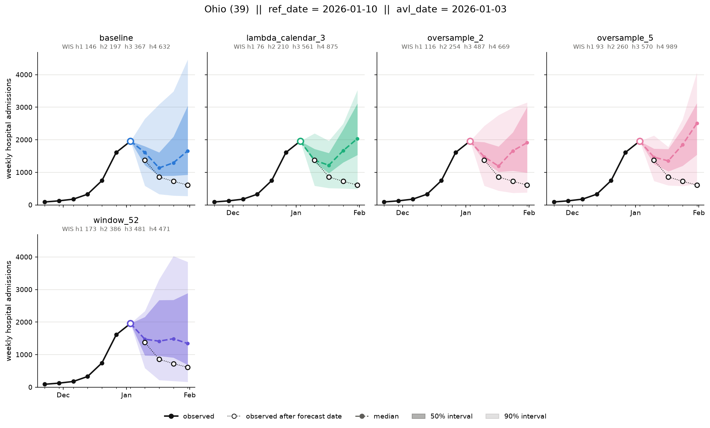

# Visual inspection: seven states, forecast dates 2025-11-29 .. 2026-02-07

Requested by A. Adiga: WIS can hide a flat-lining median or a badly placed interval, and CDC reads
the plots ("is it going up or coming down?"). This note looks at the figures from
`scripts/plot_forecasts.py` for seven states and eleven weekly forecast dates (77 figures, five
configs each: `baseline`, `lambda_calendar_3`, `oversample_2`, `oversample_5`, `window_52`), and
backs each claim with numbers from `forecasts/<config>.csv`. Fourteen representative figures are
in [`examples/inspection/`](examples/inspection/).

Conventions. A "forecast date" is the `cutoff_date` (the last observed week, the figure's
`avl_date`); the figure title's `ref_date` is one week later. "h1..h4" are 1-4 weeks ahead. Median
paths are written `h1/h2/h3/h4`. The outer band is 90% (q05-q95), not 95%. US is excluded
throughout (see README). One seed (42). **Seen** marks what the figures show; **inferred** marks an
explanation I have not tested.

States: the five largest (California, Florida, Texas, New York, Pennsylvania) and two where no
config helps at peak: North Carolina and Ohio, the two largest states at the bottom of
`wis_by_location.md` (every peak-emphasis config is worse than baseline there).

## Cross-state summary

### Three regimes, set by each state's own curve, not by the calendar

| regime | what the figures show (seen) | which config looks best |
|---|---|---|
| **Surge** (curve still rising; Nov 29 - Dec 20 in most states) | Every config under-predicts. Medians rise too slowly, and the observed point sits above the 90% band in 26% of rows (baseline, all 52 locations, Nov 29 - Dec 20); it is below q05 in 0%. Peak emphasis steepens h3-h4 and lands closer. | `oversample_5`, `lambda_calendar_3` |
| **Turn** (the 1-3 forecast dates around the state's maximum) | h1 usually does turn down with the curve, often steeply. The failure is at h3-h4: the median dips and then climbs again (a "V"), while the observed curve keeps falling. Peak emphasis makes the rebound larger and more frequent. | `baseline`, `oversample_2`; `window_52` on some dates |
| **After the turn** (Jan 17 - Feb 7) | Small and mid states: all configs are fine. The largest states (California, Florida, Texas, Pennsylvania) plateaued or rose again, and every config instead forecasts a further steep fall (h1 median about half the last value); the 90% band misses all four targets. | none; peak emphasis is slightly less wrong only because it forecasts higher |

Pooled over all 52 locations and the eleven dates (my computation from the CSVs):

| config | 90% coverage, surge | 90% coverage, turn (Dec 27 - Jan 10) | obs below q05 at turn | obs above q95 in surge | "V" share after a falling week |
|---|---:|---:|---:|---:|---:|
| baseline | 0.75 | 0.77 | 0.23 | 0.26 | 0.14 |
| lambda_calendar_3 | 0.75 | 0.62 | 0.37 | 0.25 | 0.35 |
| oversample_2 | 0.75 | 0.71 | 0.29 | 0.25 | 0.26 |
| oversample_5 | 0.75 | 0.58 | 0.41 | 0.24 | 0.32 |
| window_52 | 0.69 | 0.80 | 0.19 | 0.31 | 0.17 |

"V share": among forecasts made right after a week whose value fell more than 10% (Dec 27 - Feb 7,
last value >= 50), the share whose h1 median is below 90% of the last value and whose h4 median is
more than 20% above h1.

### What the figures show that WIS does not

1. **The post-turn error is a rebound at h3-h4, not a failure to turn.** The brief said "forecasts
   keep rising after the curve turned". That is accurate for h3-h4 only. At h1 the median usually
   falls, as in [Ohio Jan 3](examples/inspection/Ohio_2026-01-03.png) and
   [Pennsylvania Jan 10](examples/inspection/Pennsylvania_2026-01-10.png), where every config,
   baseline included, draws a V. Baseline does it too (14% of post-fall forecasts), peak emphasis
   about twice as often (26-35%). *Inferred:* the h3-h4 models lean on the calendar ("January means
   high") more than on recent momentum, and upweighting peak-phase targets strengthens that pull.
2. **The bad dates follow each state's turn, not the calendar.** Pooled, peak emphasis is worst on
   Jan 3 and Jan 10, because that is when the northeast and midwest turned. Texas turned on Dec 27,
   so its bad dates are Dec 20 - Jan 3, and on Jan 10 peak emphasis is clearly better in Texas
   ([Texas Jan 10](examples/inspection/Texas_2026-01-10.png): mean WIS 129-138 vs baseline 212).
3. **The largest states collapse after their peak, in every config.** For forecast dates Dec 27 -
   Feb 21 with a last value above 1,500, the baseline h1 median is 0.65 of the last value
   (median over 31 rows) while the observed value is 0.83; below 1,000 the two agree within 0.04.
   Of the 18 baseline h1 forecasts that halve the last value, 15 are in the five largest states.
   [Texas Jan 17](examples/inspection/Texas_2026-01-17.png) (1,214 -> h1 517, observed 1,388) and
   [Florida Jan 24](examples/inspection/Florida_2026-01-24.png) (1,567 -> h1 684, observed 1,606 and
   then a second peak of 2,515) are the clearest. *Inferred:* the same scale ceiling that breaks the
   US forecast (training max 4,729) operates in milder form near the top of the state range. This
   is not in the "known so far" list and no tested config fixes it.
4. **Intervals are badly placed rather than uniformly too wide or too narrow.** 90% coverage over
   these weeks is 0.50-0.82 in the seven states (table in the per-state sections), far below 0.90.
   During the surge the band is skewed upward (baseline, median over rows: q95 is 107% above the last
   value at h1 and 403% at h4, q05 only 31-39% below it), yet the truth still exits the top. At the turn it
   exits the bottom. The 50% band looks reasonable in the figures but covers only 0.23-0.48.
5. **Median paths zig-zag more than the data.** With a 10% threshold, 8-12% of median paths
   reverse direction twice in four weeks, against 3% of observed paths (locations with last value
   >= 200); `oversample_2` on Pennsylvania Dec 20 (1,385/1,657/1,292/1,450) is a typical case. The
   effect is modest. *Inferred:* the four
   horizon models are fit independently and nothing ties their medians together.
6. **`window_52` is not usable at the peak.** It flat-lines during every surge
   ([New York Dec 6](examples/inspection/New_York_2025-12-06.png),
   [Florida Dec 13](examples/inspection/Florida_2025-12-13.png)) and crashes far below the curve
   after the turn ([California Jan 17](examples/inspection/California_2026-01-17.png): h2-h4 about 300
   vs observed 1,650-2,150). It wins only on Jan 10 in New York, North Carolina and Ohio, where
   forecasting low happened to be right.

### Which config to trust when

- While a state is still rising: `oversample_5` or `lambda_calendar_3` for h2-h4; all configs still
  under-predict, so read the upper band.
- From the first falling week: `baseline` or `oversample_2` for h1-h2, and discount h3-h4 of every
  config (the rebound). `oversample_2` is the safest single choice across regimes: it gets most of
  the surge gain in the large states and the smallest turn penalty (90% coverage 0.71 vs 0.58-0.62
  for the other two peak configs).
- After the peak in a large state: no config is trustworthy; all of them forecast a collapse.

## California

Observed: 217 (Nov 29) -> 1,568 (Jan 3) -> dip to 1,396 (Jan 17) -> second peak 2,151 (Feb 14).

- **Nov 29:** all configs fine (WIS 43-50) except `window_52` (117).
- **Dec 6-13, surge:** baseline too slow; on Dec 13 its h3 median is 1,154 vs 1,568 observed, and
  the observed h2 point (1,247) is outside its 50% band. `lambda_calendar_3` and `oversample_5`
  track the rise (h3 1,614 and 1,566) (seen in the figure above).
- **Dec 20-27, first top:** baseline under-predicts h2-h3 by about 400-550 (Dec 20 h2 1,027 vs 1,568); peak emphasis by less (`lambda_calendar_3` 1,335).
- **Jan 3:** baseline h1 1,425 vs 1,494, close; configs are similar (WIS 158-180).
- **Jan 10-17, second rise:** the peak-emphasis V happens to be right here because California really
  did rise again. On Jan 17 `oversample_5` reaches 1,650 at h4 (observed 2,151) while baseline stays
  near 1,000 (WIS 345 vs 544)
  ([California Jan 17](examples/inspection/California_2026-01-17.png)).
- **Jan 24-31, collapse:** every config forecasts a halving. On Jan 31 the h1 median is 743-822
  against 2,074 observed, all four targets outside every 90% band
  ([California Jan 31](examples/inspection/California_2026-01-31.png)).
- **Feb 7:** peak emphasis now stays high while the curve falls (`lambda_calendar_3` h4 1,927 vs 974).

California's large peak-WIS gain for peak emphasis (-51.5 to -59.0 per row) comes mostly from
Jan 10-24 (`oversample_5`: -796 summed on Jan 17 alone) and Dec 6. *Inferred:* a large part of the
best per-state result in the table reflects the rebound coinciding with a real second wave, not
better turn-tracking.

## Florida

Observed: 738 (Nov 29) -> 2,657 (Jan 3) -> 1,567 (Jan 24) -> second peak 2,515 (Feb 14).

- **Dec 13, surge:** every config is low at h1 (about 1,050 vs 1,557); baseline's h1-h2 targets sit
  above its 90% band. Peak emphasis gets closer at h3 (`lambda_calendar_3` 1,954, baseline 1,336,
  observed 2,657) ([Florida Dec 13](examples/inspection/Florida_2025-12-13.png)). This one date is
  Florida's largest gain (-925 summed, `lambda_calendar_3`).
- **Dec 27 - Jan 3, turn:** all configs draw a V; peak emphasis rebounds harder (`oversample_5`
  Jan 3 h4 2,809 vs 1,606). These are Florida's worst dates for peak emphasis (+356 to +404).
- **Jan 17 - Feb 7, plateau and second wave:** every config forecasts a fall to 300-900 while
  Florida held near 1,600 and rose to 2,515. Mean WIS is about 1,300-1,400 on Jan 24 and Jan 31,
  the worst of any Florida date, and the configs differ by under 10%
  ([Florida Jan 24](examples/inspection/Florida_2026-01-24.png)).

Florida has the lowest 90% coverage of the seven (0.43-0.59). Its baseline peak WIS (654.5, the
highest of any state) is driven by the post-peak collapse, which no config addresses.

## Texas

Observed: 591 (Nov 29) -> 2,847 (Dec 27) -> 1,214 (Jan 17) -> plateau about 1,350 through Feb 14.

- **Nov 29 - Dec 13, surge:** baseline too low (Dec 13 h2 1,370 vs 2,847); `lambda_calendar_3` and
  `oversample_5` reach about 1,700-1,940 at h2.
- **Dec 20, last rising week:** baseline and `oversample_2` turn at h2-h3 in time; `lambda_calendar_3`
  keeps rising to 2,567 at h4 against 1,214 observed (h4 WIS 701 vs 330)
  ([Texas Dec 20](examples/inspection/Texas_2025-12-20.png)).
- **Dec 27 - Jan 3:** the peak-emphasis penalty dates for Texas (one week earlier than the pooled
  Jan 3-10 pattern).
- **Jan 10:** peak emphasis is right: `oversample_5` sits on the plateau (1,360/1,439/1,269/1,411 vs
  1,214/1,388/1,326/1,395); baseline is low at about 1,000
  ([Texas Jan 10](examples/inspection/Texas_2026-01-10.png)).
- **Jan 17 - Jan 31, collapse:** one more falling week and every config forecasts a drop to
  300-500; the plateau at 1,350 is outside every 90% band
  ([Texas Jan 17](examples/inspection/Texas_2026-01-17.png)). The forecast for the same target weeks (Jan 31,
  Feb 7) fell by half (baseline) to about 70% (`oversample_5`) between the Jan 10 and Jan 17 forecast
  dates, on one new observation.

## New York

Observed: 701 (Nov 29) -> 3,870 (Dec 27) -> 3,800 (Jan 3) -> fast fall to about 300 by Jan 31.

- **Nov 29 - Dec 6, surge:** the fastest rise of the seven and the worst under-prediction (WIS
  1,134-1,557 on Nov 29). On Dec 6 the baseline h1 median *dips* to 1,038 below the last value
  1,184 while the curve went to 1,935; `lambda_calendar_3` and `oversample_5` reach 2,990 and 2,860 at
  h4 vs 3,800
  ([New York Dec 6](examples/inspection/New_York_2025-12-06.png)).
- **Dec 13-20:** peak emphasis better (Dec 13 `oversample_5` WIS 515 vs 817).
- **Dec 27, at the top:** baseline turns one week early (h1 2,175 vs 3,800). Peak emphasis keeps h1
  near 3,000-3,300 and is better there; every config then falls with the curve
  ([New York Dec 27](examples/inspection/New_York_2025-12-27.png)).
- **Jan 3-10, post-turn:** every config, baseline included, rebounds at h4 on Jan 3 (1,792-1,988 vs
  411); peak emphasis is also higher at h1-h3. On Jan 10 baseline
  flat-lines near 1,000 at h2-h4 while the curve falls to 300; `window_52` is best (WIS 228).
- **Jan 17 onward:** values are small and every config except `window_52` is fine (WIS 26-56).

## Pennsylvania

Observed: 349 (Nov 29) -> 3,316 (Jan 3) -> 1,035 (Jan 24) -> plateau about 800 through Mar 7.

- **Dec 6-20, surge:** all configs low. On Dec 13 baseline h3 is 1,159 vs 3,316; `lambda_calendar_3`
  1,662. On Dec 20 the baseline h1 dips below the last value (1,111 vs 1,256) while the curve nearly
  doubled.
- **Dec 27 - Jan 3:** peak emphasis higher and better on Dec 27; similar on Jan 3.
- **Jan 10, post-turn:** the clearest V of the seven (figure above). Baseline h1 1,070 vs 1,870
  (too steep), h4 back up to 1,443 vs 841; `lambda_calendar_3` and `oversample_5` climb to about
  2,200 at h3-h4 (WIS 479 and 464 vs 289). Pennsylvania's worst peak-emphasis date (+699 to +762
  summed).
- **Jan 24 - Feb 7, plateau:** every config forecasts a continued fall (h1 about 530 vs 1,035 on
  Jan 24; h3 about 300 vs 806 on Feb 7).

## North Carolina (no config helps)

Observed: 159 (Nov 29) -> 2,461 (Dec 27) -> 617 (Jan 17) -> 369 (Feb 7). The sharpest peak of
the seven: up 15x in four weeks, then down 75% in three.

- **Nov 29 - Dec 13, surge:** every config far too low, and peak emphasis barely helps (Dec 6 h3
  608-745 vs 2,461). The rise was too fast for any config.
- **Dec 20:** `oversample_5` h1 1,620 is the closest to 2,461.
- **Dec 27, at the top:** every config turns down at h1-h3, roughly with the curve, then rebounds at
  h4 (`lambda_calendar_3` 1,893 vs 497)
  ([North Carolina Dec 27](examples/inspection/North_Carolina_2025-12-27.png)).
- **Jan 3-10, post-turn:** baseline flat-lines at 1,200-1,400 on Jan 10 while the curve falls from
  1,360 to 369; peak emphasis climbs to about 1,850 (figure above). The 90% bands are so wide that
  baseline still covers the truth, which is why its WIS (448) is not worse. `window_52` is best
  (305).
- **Jan 17 onward:** fine for every config except `window_52` (WIS 22-54).

North Carolina gets little surge gain because every config misses that rise, while the post-turn
rebound costs fully; that matches its position at the bottom of `wis_by_location.md`.

## Ohio (no config helps)

Observed: 125 (Nov 29) -> 1,958 (Jan 3) -> 514 (Feb 7) -> small second rise to 663 (Feb 21).

- **Dec 6-13, surge:** all configs low (Dec 13 h2 497-594 vs 1,610); peak emphasis adds little.
- **Dec 27:** `oversample_5` h1 1,821 vs 1,958 is better, but its h4 is 1,876 vs 724.
- **Jan 3, at the top:** every config draws a V (figure above). Baseline h1 1,609 is reasonable
  (observed 1,377), but its h4 climbs to 1,661 vs 610; `oversample_5` climbs to 2,503.
- **Jan 10:** baseline h3 1,339 vs 610; peak emphasis 1,923-2,068; `window_52` best (174).
- **Jan 17:** baseline best (WIS 84); peak emphasis rebounds again at h4.
- **Jan 24 - Feb 7:** all configs mildly low (h1 about 500 vs 610 on Jan 24).

## 90% coverage per state (forecast dates Nov 29 - Feb 7, all horizons)

| state | baseline | lambda_calendar_3 | oversample_2 | oversample_5 | window_52 |
|---|---:|---:|---:|---:|---:|
| California | 0.68 | 0.77 | 0.66 | 0.77 | 0.57 |
| Florida | 0.59 | 0.48 | 0.50 | 0.52 | 0.43 |
| New York | 0.75 | 0.77 | 0.80 | 0.82 | 0.75 |
| North Carolina | 0.77 | 0.70 | 0.77 | 0.64 | 0.68 |
| Ohio | 0.59 | 0.61 | 0.59 | 0.61 | 0.61 |
| Pennsylvania | 0.50 | 0.55 | 0.52 | 0.55 | 0.52 |
| Texas | 0.50 | 0.57 | 0.55 | 0.59 | 0.50 |

## Checked against the "known so far" list

| claim | verdict |
|---|---|
| Pooled peak WIS baseline 119.7 | Confirmed (`summary.md`: 119.73). |
| Peak emphasis lowers WIS a lot on Nov 29 - Dec 20 and raises it a lot on Jan 3 and Jan 10 | Confirmed pooled (`wis_by_week.md`). Per state the bad dates are the 1-3 weeks after the state's own maximum: Dec 20 - Jan 3 in Texas, Dec 27 - Jan 3 in Florida, Jan 3-10 in the northeast and Ohio. On Jan 10 peak emphasis is better in Texas. |
| Forecasts keep rising after the curve turned | Refined: h1 usually turns, often too steeply; the rise is at h3-h4 (a V). Baseline does it as well, peak emphasis about twice as often. |
| Gains concentrate in large states | Confirmed, but the mechanism is mixed: California's gain comes largely from Jan 10-24 when it had a real second rise, and part of the Texas and Florida gain comes from Jan 24-31, when every config under-predicts and a higher forecast is less wrong. |
| No config beats baseline in more than 22 of 52 locations | Confirmed (`oversample_2` 22/52). |
| US forecasts invalid; outer band is 90% | Accepted from the README; US not inspected. |
| (new) | Largest states collapse after their peak in every config (h1 median about 0.65 of the last value above 1,500 vs 0.83 observed); 90% coverage is about 0.75 pooled and 0.43-0.82 in these states. |

## Limits

- One seed. I looked at 22 of the 77 figures closely and read the rest through the numbers in the
  CSVs; every per-state claim above was checked against the CSV values.
- The mechanisms marked *inferred* (calendar pull at h3-h4, scale ceiling in large states,
  independent horizon models causing zig-zags) are hypotheses. Feature attribution on the h4 model
  at Jan 3-10 and a check of the training-target distribution above 1,500 would test the first two.
- The regime boundaries are read from each state's curve by eye, not computed.
